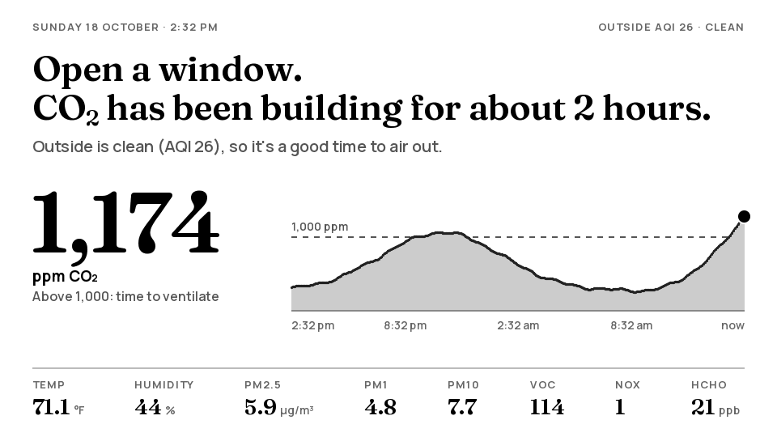
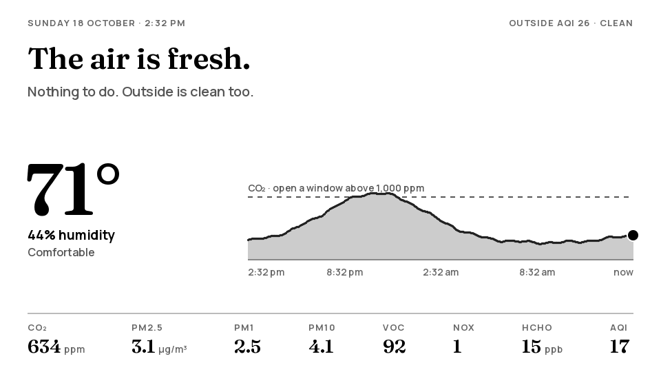
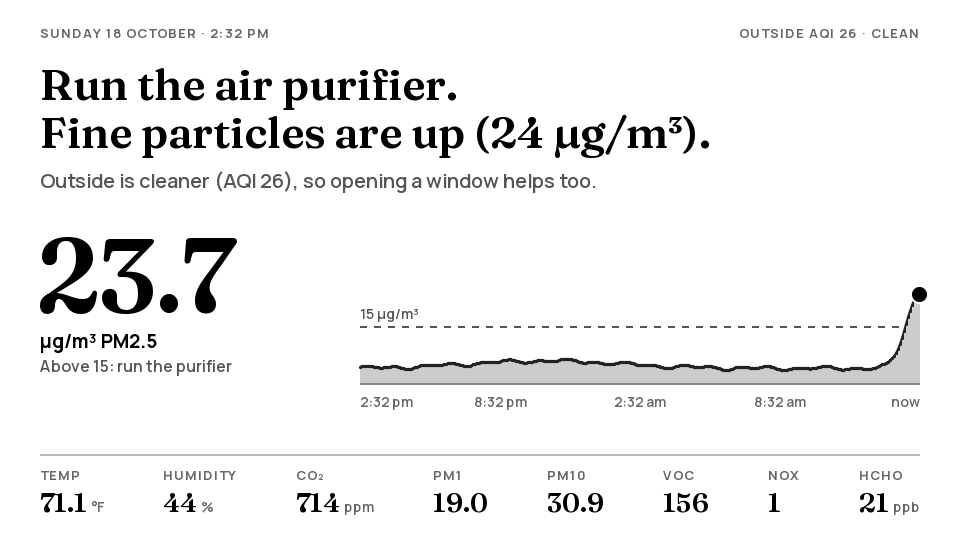
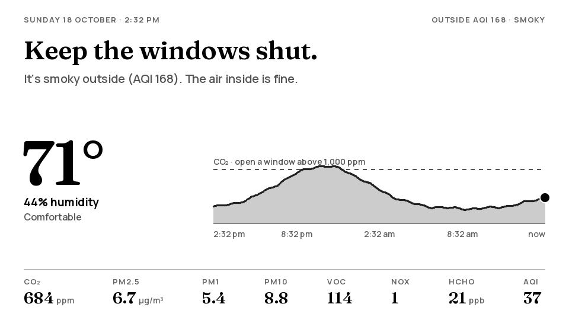
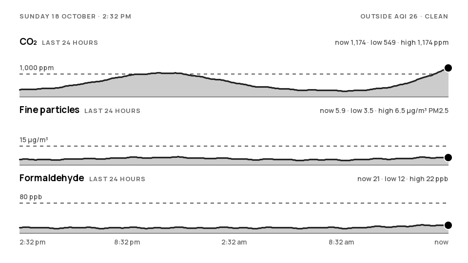

# PaperAir

An air quality display for the living room, on the M5Stack PaperDIY's 4.7" e-paper screen.

Most air monitors show a wall of numbers. PaperAir says in plain words whether to do anything,
shows the reading behind that advice with its last 24 hours, and keeps every other reading
in a quiet row along the bottom.



| | |
|---|---|
|  |  |
|  |  |

These pictures come from the desktop preview, which runs the same drawing code as the device and
reduces it to the panel's 16 greys.

## What it tells you

The headline is always one thing to do, most urgent first:

| Situation | Headline | Limit |
|---|---|---|
| CO₂ very high | Open a window now. | 1,500 ppm |
| Lots of fine particles | Run the air purifier. | PM2.5 35.5 µg/m³ |
| Formaldehyde high (with an SFA40) | Air out the room. | 80 ppb |
| Fine particles up | Run the air purifier. | PM2.5 15 µg/m³ |
| Strong smells or fumes | Air out the room. | VOC index 250 |
| Gas stove fumes | Turn on the kitchen fan. | NOx index 50 |
| CO₂ building up | Open a window. | 1,000 ppm |
| Smoke outside | Keep the windows shut. | outdoor AQI above 150 |
| Dry or humid | The air is dry. / The air is humid. | below 30% / above 60% |
| A little above usual | The air is fine. | CO₂ 800, PM2.5 9, HCHO 40, VOC 150, NOx 20 |
| Otherwise | The air is fresh. | |

Outdoor air changes the advice. When it's smoky outside, "Open a window" becomes "Air out briefly".
For indoor particles, it suggests opening a window only when the outside air is cleaner.

Where the limits come from:
- **CO₂:** German Federal Environment Agency guidance.
- **PM2.5:** US EPA AQI breakpoints and the WHO 2021 24-hour guideline.
- **Formaldehyde:** Health Canada and the WHO.
- **VOC and NOx:** Sensirion's index scales.

They're all in [`lib/air/src/advice.h`](lib/air/src/advice.h) if you'd like to change them.

## Hardware

- **M5Stack PaperDIY** (K159-B): an ESP32-S3 with 16 MB flash and 8 MB PSRAM, driving a 4.7" 960×540
  e-paper panel.
- **Sensirion SEN66:** PM1 to PM10, CO₂, VOC and NOx index, temperature and humidity.
- **Sensirion SFA40** (optional): formaldehyde. PaperAir finds it at startup. Without one, the
  formaldehyde reading and its chart are left out.

Both sensors share the PaperDIY's system I2C bus with its power chip:

| PaperDIY | SEN66 | SFA40 |
|---|---|---|
| 3V3 | VDD | VDD |
| GND | GND | GND |
| G41 (SDA) | SDA | SDA |
| G42 (SCL) | SCL | SCL |

The addresses don't clash (power chip 0x6E, SEN66 0x6B, SFA40 0x5D), and the bus already has
pull-up resistors. The SEN66 has a fan and a CO₂ sensor, so it draws more current than most I2C
parts. Power it from a 3.3 V supply pin, not a GPIO.

### Enclosures

[`enclosure/`](enclosure) has two 3D-printed designs, each with the SEN66 and SFA40 inside, plus
the FPC wiring:
- **A slim frame** for the bare board and panel.
- **A desk stand** for a PaperDIY in M5Stack's case.


## Setting it up

1. Install [PlatformIO](https://platformio.org/install) (the VS Code extension or the command line).
2. Connect the PaperDIY by USB and run `pio run -t upload`. Use `pio device monitor` to watch the
   log.
3. The screen says "Set me up" and the PaperDIY opens a Wi-Fi hotspot called **PaperAir-Setup**
   (password `paperair`). Join it with a phone; the settings page opens by itself (or go to
   http://192.168.4.1/). Pick your Wi-Fi, enter its password, and fill in:
   - a PurpleAir read key and the sensor index of a PurpleAir sensor near you, plus a backup if you
     like
   - an AirNow key and your ZIP code, used as the fallback
   - °F or °C, the 12/24-hour clock, the time zone, and a password for the web page
   - a static IP address if you want one (DHCP otherwise), and whether to roam on a mesh
     network (join the strongest access point, and move when the signal gets weak)

   Save, and the PaperDIY joins your network. Everything is kept in flash on the device, so a
   `git pull` and a new upload never touch it.

You can skip the hotspot by copying `include/secrets.example.h` to `include/secrets.h` and
filling it in before uploading; those become the defaults. `secrets.h` is ignored by git, so
none of it leaves your computer. [`include/config.h`](include/config.h) has the rest: flipping the
screen, the red LED on the back and how often the screen refreshes.

### The web page

On your network, open **http://paperair.local/** (or the IP address from the serial log) and sign
in with the web password. It shows what the screen shows plus more: every reading with a good /
elevated / high mark and a sparkline, a 24-hour chart of any reading (tap a tile; hover for the
value at a time; 1 h to 24 h ranges with the watch and act levels shaded), the outdoor AQI, and the
device's state. Buttons refresh the screen, switch its page, download the history as CSV, and
restart. **Settings** changes everything the setup hotspot did, with a Wi-Fi scan, and can open the
hotspot again.

Other things on the network can read the same data, sending the web password as a bearer token:

```
curl -H "Authorization: Bearer <password>" http://paperair.local/api/now
curl -H "Authorization: Bearer <password>" http://paperair.local/api/history
```

`/api/now` has the readings, advice, outdoor air and device state; `/api/history` the 24 hours at
5-minute steps, oldest first. `/history.csv` is the same as a spreadsheet.

### Updating over Wi-Fi

Once it's on the wall you don't need the cable. After a `git pull`, either

- `pio run -e paperdiy-ota -t upload` sends the new firmware to `paperair.local` with the web
  password (`PAPERAIR_PASSWORD=... ` in front if you changed it on the settings page, and
  `PAPERAIR_HOST=192.168.1.50` if mDNS doesn't resolve on your computer), or
- build with `pio run`, then on the settings page choose `.pio/build/paperdiy/firmware.bin`
  under **Firmware** and press Install.

The settings and the 24-hour history stay. A new firmware runs as "not confirmed" until it has
answered a web request and run for half a minute (or run for five minutes); if it crashes or
restarts before that, the bootloader goes back to the previous one. The previous firmware stays in
the other flash slot, and **Boot the previous firmware** on the settings page gets it back at any
time.

### Setup mode

The hotspot opens by itself when there is no Wi-Fi saved, when joining keeps failing for a
minute, or when the **G3** button is held for 3 seconds (hold it again, or wait 15 minutes, to
close it). While it is open the screen says how to reach it.

### Buttons

| Button | Does |
|---|---|
| G4 | Switch between the main page and the 24-hour trends. The trends page goes back by itself after 2 minutes. |
| G3 | A full black-and-white refresh, to clear any ghosting. One also happens every hour. Held for 3 seconds: open or close the setup hotspot. |

The 24-hour history is saved to flash every 5 minutes and comes back after a restart or a power
cut, with a gap for the time the PaperDIY was off.

### Temperature offset

Once the SEN66 is in its enclosure, compare its temperature with a thermometer for an hour. Put the
difference in the settings page (or `kTemperatureOffsetC` in `config.h`). Humidity is corrected to
match.

## Outdoor air

PaperAir tries three sources in order:

1. The main PurpleAir sensor.
2. The backup PurpleAir sensor.
3. AirNow.

The first recent, sensible reading wins. PurpleAir readings get the US EPA correction
(Barkjohn et al. 2021, with the smoke extension used on the AirNow Fire and Smoke Map). PaperAir
skips a PurpleAir sensor when it:
- is marked as indoor
- hasn't reported for 30 minutes
- has two laser channels that disagree

Outdoor air is fetched every 10 minutes, which is about 4,300 PurpleAir requests a month.

## Working on it

```sh
pio test -e native            # unit tests for the maths, parsing and advice
pio run -e preview -t exec    # redraw preview/*.png (needs SDL2: apt install libsdl2-dev / brew install sdl2)
python tools/make_fonts.py    # regenerate the fonts after changing a size (needs pillow and fonttools)
```

| Folder | Holds |
|---|---|
| `lib/air` | Plain C++ with no hardware: AQI, EPA correction, humidity compensation, PurpleAir and AirNow parsing, the 24-hour history and its save format, the Sensirion protocol checks, and the advice. It's all tested on a PC. |
| `lib/ui` | The screens, drawn with M5GFX into a 960×540 canvas. The device and the desktop preview share this code. |
| `src` | The device: sensor drivers, Wi-Fi and outdoor air, buttons, and when to refresh the screen. |
| `preview` | The desktop preview. |

## Licence

The code is under the MIT licence; see [LICENSE](LICENSE).

The fonts are [Fraunces](https://github.com/undercasetype/Fraunces) and
[Manrope](https://github.com/googlefonts/manrope), under the SIL Open Font License 1.1. Their
licence texts are in [`fonts/`](fonts). The bitmap versions in `lib/ui/src/fonts` are made from
them with `tools/make_fonts.py` and carry the same licence.
