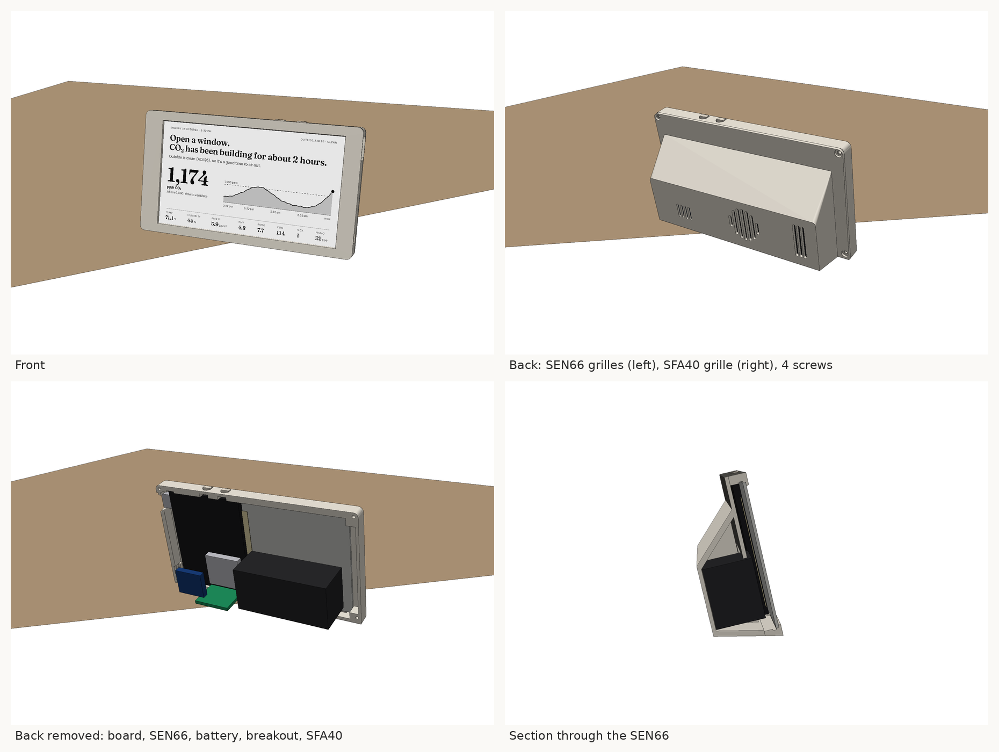
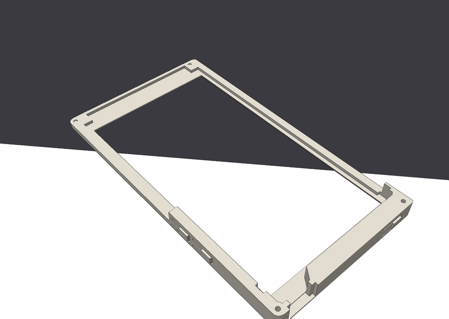

# Enclosures

Two ways to house the PaperDIY with the sensors:

- **[Slim frame](#slim-frame)**: for the bare PaperDIY board and panel, without M5Stack's case. A
  thin printed frame around the screen, with a foot at the bottom-back for the sensors.
- **[Desk stand](#desk-stand)**: for a PaperDIY in M5Stack's case. A low base that the PaperDIY
  stands in.

Both need `kFlipScreen = true` in `include/config.h`, because the PaperDIY's buttons end up on top.

## Slim frame

- **Screen:** the panel sits behind a printed lip with no acrylic. The lip overlaps the picture by
  0.3 mm (3 pixels, inside the screen's own margin), so none of the panel's black border shows.
  Small stops at the corners hold the glass in place.
- **Board:** sits behind the right-hand end of the glass and reaches 4.5 mm past it. Its end rests
  against the right-hand wall, and its two nubs sit in recesses that locate it across.
  - **Buttons:** G4 and G3 come through the top edge under two printed caps.
  - **Power switch:** also under a cap, on the right end.
  - **USB-C:** opening on the right end, near the top.
- **Foot:** at the bottom-back, 28.5 mm deep. It holds:
  - **SEN66:** behind the left half of the glass, breathing through two grilles in the back.
  - **SFA40:** behind its own small grille on the right.
  - **FPC breakout, its capacitor and the battery:** behind the board.
- **Cable:** the FPC cable runs down inside, along the board's inner edge.
- **Sizes:** 125 wide × 68 tall × 36 deep. The screen part is 9 mm thick.

### Parts

| File | Print | Notes |
|---|---|---|
| `stl/frame_fit_test.stl` | **Print this first**, face down as exported | About an hour. See the checks below. |
| `stl/frame_bezel.stl` | Face down, as exported | No supports |
| `stl/frame_back.stl` | Flat ring down, as exported | No supports. The grille bridges are about 30 mm long. |
| `stl/frame_caps.stl` | Standing on end, as exported, with a brim | Three caps, 5 mm tall. Two are for the top buttons; the one with the longer ridge is for the power switch. No overhangs. |
| `stl/frame_backer.stl` | Flat, as exported | Backing plate. The panel is flexible, so this holds it flat against the lip. |

### Fit test

Drop the plugged-together panel and board into it, face down, then check:

1. **Pocket:** the glass drops in without forcing, with its left end between the two stops, and
   doesn't rattle. Near the right end, the board has a small nub on each long edge. Each nub sits in
   its own recess, and the board's end touches the right-hand wall.
2. **Lip:** from the front, the lip covers the glass edge on all four sides but none of the
   picture beyond its outermost 3 pixels. Press G3 to flash the screen black and look at the
   edges. The picture is 4 mm from the glass's flex end and 1.5 mm from its board end, so the lip
   is wider on the left.
3. **Buttons:** put the caps in from the inside. Each should click its switch with a light press,
   and the screen shouldn't change unless you press. The power cap does the same on the right end.
4. **USB-C:** a cable plugs in fully.

If anything is off, tell me what you see, or change the measurement constants at the top of
`make_frame.py`. Each is labelled.

### Hardware

| Qty | Part |
|---|---|
| 4 | M2 × 6 screws, thread-forming ("PT") or plain M2 (they cut their own thread in the printed holes) |
| 4 | 10 mm round rubber feet, 2 mm thick |
| — | Double-sided foam tape: 2 mm for a strip down the back of the board (it compresses to 1.7), 1 mm for the SFA40 board and the breakout |
| 1 | FPC cable, 12-way 0.5 mm, 150 mm, the same as for the stand, plus the breakout and capacitor (see Wiring) |

### Assembly

1. Put the three caps into their openings from the inside.
2. Lay the panel face down in the bezel, with the board on the right-hand end. Plug the FPC cable
   into the board's FPC-I2S socket and the battery into its socket.
3. Clip the backing plate in behind the panel, left of the board, bevelled side first. Seat one
   long edge in its groove, bow the plate slightly, and press the other edge down until it clicks
   in. Its shallow channel goes over the panel's flex strip.
4. Put a strip of 2 mm foam tape down the back of the board, clear of its connectors. The back plate
   compresses it to 1.7 mm, which holds the board against the glass. Push the board's end against the
   right-hand wall before closing up: that's what lines its buttons up with their caps.
5. In the back part:
   - Press the SEN66 between its ribs, grilles side against the back wall. The ribs grip it.
   - Stick the SFA40's carrier board to the inside of its grille, sensor can facing out and its four
     solder pads toward the SEN66. Solder the wires on before it goes in.
   - Stick the breakout and the battery behind the board area.
6. Run the FPC cable down along the board's inner edge to the breakout. Wire the sensors (see Wiring).
7. Close the back and fit the four screws. Stick the feet into their recesses.

The stiff part of the panel's flex reaches about 5 mm past the glass's left end. It lies flat between
the two stops at the left-hand corners, with room before the wall, and the flex loops up from it and
over the back of the panel to the board. The stops, and two at the right-hand corners, hold the glass
in place along its length. The board is a separate part, joined to the panel only by the flex, and
rests with its end against the right-hand wall.

### Measured, and worth checking

Most of the numbers come from M5Stack's dimension drawings of the panel, the board and the case,
and from the case model in
[M5_Hardware](https://github.com/m5stack/M5_Hardware/tree/master/Products/K159-B_PaperDIY_Complete_Kit),
checked against fit-test prints:
- the board's end, 4.46 mm past the glass, and its button, USB-C and power switch positions,
  measured from that end
- the two nubs on the board's long edges. They make it 64.2 mm across, against 62 mm for the glass
  (`NUBS_X`, `NUB_OUT`).
- the panel thickness, 1.2 mm. The backing plate's grooves are set from it (`GLASS_T`).

From calipers and the fit tests:
- the glass, 110.5 × 62 mm (the drawing says 62.5; if yours is, `GLASS_H` in `make_frame.py`)
- the picture's position on the glass: 4 mm from the flex end, 1.5 mm from the board end
  (`ACTIVE_X`). This is the one to check first if the lip covers the picture or shows the border.
- the board's inner edge, and how far the button actuators stick out

The fit test checks all of them. The constants are at the top of `make_frame.py`.

## Desk stand

A low base that the PaperDIY stands in, leaning back 12°, with the SEN66 and the optional SFA40
inside it.

- **The PaperDIY stands upside down** compared with how it ships, so its two buttons are on the
  top edge. The USB-C port and the power button end up on the left end. Set `kFlipScreen` in
  `include/config.h` if the picture comes out upside down.
  - Left button on the top edge: G3, full refresh.
  - Right button on the top edge: G4, switches between the main and trends pages.
- **The SEN66** lies against the back wall. It breathes through two grilles: the inlet at the right
  and the fan outlet in the middle. The solid wall between them keeps outlet air out of the inlet.
- **The SFA40** slides into a bay at the left end, sensor facing the small grille. It works by
  diffusion, so it needs no fan.
- **The FPC cable** connects the PaperDIY to the sensors:
  1. It leaves the PaperDIY through a slot in its back plate.
  2. It runs down a groove behind the PaperDIY, hidden by the spine.
  3. It drops through a hole in the slot floor into the base, where the breakout board sits loose
     in the front-left corner.
- **The front of the base steps down,** so the base doesn't hide the bottom row of readings.

Sizes: base 132 × 56 × 32 mm; with the PaperDIY in it, 91 mm tall.

### Parts

| File | Print | Notes |
|---|---|---|
| `stl/stand_base.stl` | Upside down, as exported | Turn on supports **touching the build plate only**. They're needed only under the 4 mm step at the front. Everything else (grilles, slot, ribs) prints without them. |
| `stl/stand_bottom.stl` | Flat, as exported | Countersunk holes and foot recesses face the bed |
| `stl/stand_spine.stl` | Flat on its back, as exported | Push it into the socket behind the slot. A drop of glue is optional. |
| back plate with FPC slot | Floor down, like M5Stack's | Generated from M5Stack's model; see below |

**Back plate.** Make it with
`python make_stand.py --out stl --oem PaperDlY_Complete_Kit.stl`, using M5Stack's model from
[M5_Hardware](https://github.com/m5stack/M5_Hardware/tree/master/Products/K159-B_PaperDIY_Complete_Kit/Structures)
(MIT licence, © M5Stack).

Alternatively, cut the slot into the back plate you have. It's 1.2 mm thick PLA, so a hobby
knife works. The slot is 5 × 13 mm. Seen from the screen side, with the case as it ships (buttons
on the bottom edge):
- 63.5–68.5 mm from the left edge
- 47.5–60.5 mm from the top edge

**Check the slot position before printing or cutting.** I worked it out from M5Stack's pinmap
photo, which I scaled using the ESP32 module. The board's other parts line up with the back
plate's windows to within about 1.5 mm. With the back off, the FPC-I2S connector should be 71–76 mm
from the left and 49–59 mm from the top, with its cable leaving towards the left. If yours is
elsewhere, change `BACKPLATE_SLOT` in `make_stand.py`.

### Hardware

| Qty | Part |
|---|---|
| 4 | M3 × 5.7 heat-set insert (4.4 mm holes, into the base's corner bosses from below) |
| 4 | M3 × 8 countersunk screw (bottom plate) |
| 4 | 10 mm round rubber feet (optional) |
| 1 | FPC cable, 12-way, 0.5 mm pitch, 150 mm. Which contact side you need depends on the breakout, so buy one of each ("A", same side, and "B", opposite sides); they're cheap. |
| 1 | FPC breakout board, 12-way 0.5 mm to 2.54 mm pins |
| 1 | 220 µF capacitor, 6.3 V or more (recommended, see below) |

## Wiring

The cable goes into the **FPC-I2S** connector, the one nearer the buttons. On the PaperDIY's side:

| Pin | Signal | Goes to |
|---|---|---|
| 4 | G41 SYS_SDA | SDA on the SEN66 and SFA40 |
| 5 | G42 SYS_SCL | SCL on both |
| 2, 6 | GND | GND on both |
| 11, 12 | 3V3_AU | VDD on both |

- **Check the breakout's pin numbers before connecting the sensors.** A cable with contacts on
  opposite sides reverses the order.
  1. With the PaperDIY on USB, find the two neighbouring pins that read 3.3 V against a GND pin.
     Those are 11 and 12.
  2. Count the other pins from there.
- **3V3_AU** comes from its own 300 mA regulator, which is on whenever the PaperDIY has power.
  The SEN66 averages about 90 mA, but its fan and CO₂ sensor draw up to 350 mA in 2 ms bursts. So
  solder the 220 µF capacitor across 3V3 and GND on the breakout. Mind the polarity of an
  electrolytic capacitor.
- The bus already has pull-up resistors (it's shared with the PaperDIY's power chip), so the
  sensors need none.

### Changing the stand

Everything is set by the constants at the top of `make_stand.py`:
- the SEN66 and SFA40 sizes
- the slot clearance and lean
- the base size
- the insert hole size
- the back plate slot

Run `python make_stand.py --out stl` after a change (needs `pip install trimesh manifold3d numpy`).
