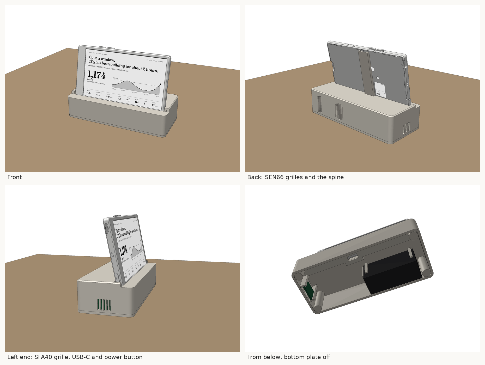
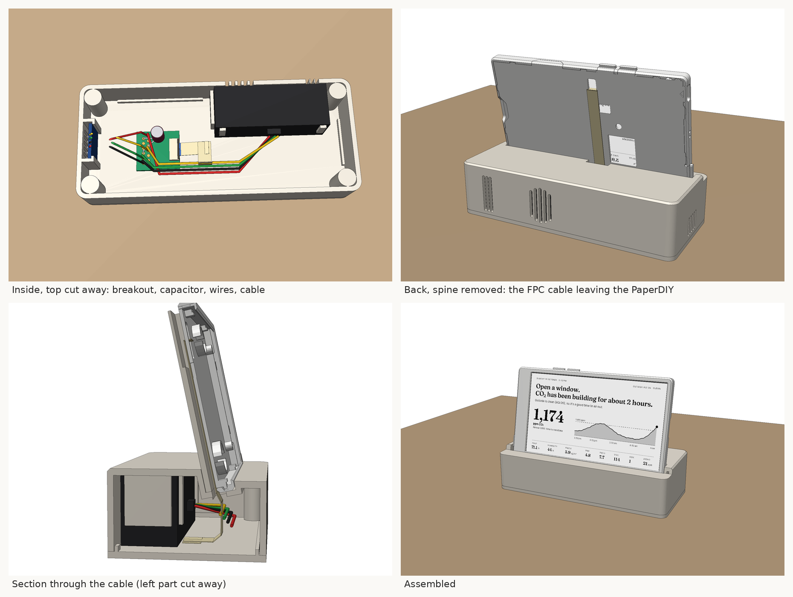

# Desk stand with sensors

A low base that the PaperDIY stands in, leaning back 12°, with the SEN66 and the optional SFA40
inside it.

- **The PaperDIY stands upside down** compared with how it ships, so its two buttons are on the
  top edge. The USB-C port and the power button end up on the left end. Set `kFlipScreen` in
  `include/config.h` if the picture comes out upside down.
  - Left button on the top edge: G3, full refresh.
  - Right button on the top edge: G4, switches between the main and trends pages.
- **The SEN66** lies against the back wall. It breathes through two grilles: the inlet at the right
  and the fan outlet in the middle. The solid wall between them keeps outlet air out of the inlet.
- **The SFA40** slides into a bay at the left end, sensor facing the small grille. It works by
  diffusion, so it needs no fan.
- **The FPC cable** connects the PaperDIY to the sensors:
  1. It leaves the PaperDIY through a slot in its back plate.
  2. It runs down a groove behind the PaperDIY, hidden by the spine.
  3. It drops through a hole in the slot floor into the base, where the breakout board sits loose
     in the front-left corner.
- **The front of the base steps down,** so the base doesn't hide the bottom row of readings.

Sizes: base 132 × 56 × 32 mm; with the PaperDIY in it, 91 mm tall.

## Parts

| File | Print | Notes |
|---|---|---|
| `stl/stand_base.stl` | Upside down, as exported | Turn on supports **touching the build plate only**. They're needed only under the 4 mm step at the front. Everything else (grilles, slot, ribs) prints without them. |
| `stl/stand_bottom.stl` | Flat, as exported | Countersunk holes and foot recesses face the bed |
| `stl/stand_spine.stl` | Flat on its back, as exported | Push it into the socket behind the slot. A drop of glue is optional. |
| back plate with FPC slot | Floor down, like M5Stack's | Generated from M5Stack's model; see below |

**Back plate.** Make it with
`python make_stand.py --out stl --oem PaperDlY_Complete_Kit.stl`, using M5Stack's model from
[M5_Hardware](https://github.com/m5stack/M5_Hardware/tree/master/Products/K159-B_PaperDIY_Complete_Kit/Structures)
(MIT licence, © M5Stack).

Alternatively, cut the slot into the back plate you have. It's 1.2 mm thick PLA, so a hobby
knife works. The slot is 5 × 13 mm. Seen from the screen side, with the case as it ships (buttons
on the bottom edge):
- 63.5–68.5 mm from the left edge
- 47.5–60.5 mm from the top edge

**Check the slot position before printing or cutting.** I worked it out from M5Stack's pinmap
photo, which I scaled using the ESP32 module. The board's other parts line up with the back
plate's windows to within about 1.5 mm. With the back off, the FPC-I2S connector should be 71–76 mm
from the left and 49–59 mm from the top, with its cable leaving towards the left. If yours is
elsewhere, change `BACKPLATE_SLOT` in `make_stand.py`.

## Hardware

| Qty | Part |
|---|---|
| 4 | M3 × 5.7 heat-set insert (4.4 mm holes, into the base's corner bosses from below) |
| 4 | M3 × 8 countersunk screw (bottom plate) |
| 4 | 10 mm round rubber feet (optional) |
| 1 | FPC cable, 12-way, 0.5 mm pitch, 150 mm. Which contact side you need depends on the breakout, so buy one of each ("A", same side, and "B", opposite sides); they're cheap. |
| 1 | FPC breakout board, 12-way 0.5 mm to 2.54 mm pins |
| 1 | 220 µF capacitor, 6.3 V or more (recommended, see below) |

## Wiring

The cable goes into the **FPC-I2S** connector, the one nearer the buttons. On the PaperDIY's side:

| Pin | Signal | Goes to |
|---|---|---|
| 4 | G41 SYS_SDA | SDA on the SEN66 and SFA40 |
| 5 | G42 SYS_SCL | SCL on both |
| 2, 6 | GND | GND on both |
| 11, 12 | 3V3_AU | VDD on both |

- **Check the breakout's pin numbers before connecting the sensors.** A cable with contacts on
  opposite sides reverses the order.
  1. With the PaperDIY on USB, find the two neighbouring pins that read 3.3 V against a GND pin.
     Those are 11 and 12.
  2. Count the other pins from there.
- **3V3_AU** comes from its own 300 mA regulator, which is on whenever the PaperDIY has power.
  The SEN66 averages about 90 mA, but its fan and CO₂ sensor draw up to 350 mA in 2 ms bursts. So
  solder the 220 µF capacitor across 3V3 and GND on the breakout. Mind the polarity of an
  electrolytic capacitor.
- The bus already has pull-up resistors (it's shared with the PaperDIY's power chip), so the
  sensors need none.

## Changing it

Everything is set by the constants at the top of `make_stand.py`:
- the SEN66 and SFA40 sizes
- the slot clearance and lean
- the base size
- the insert hole size
- the back plate slot

Run `python make_stand.py --out stl` after a change (needs `pip install trimesh manifold3d numpy`).
